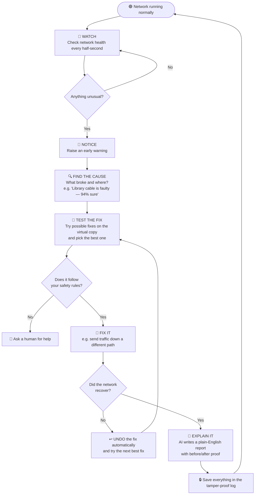
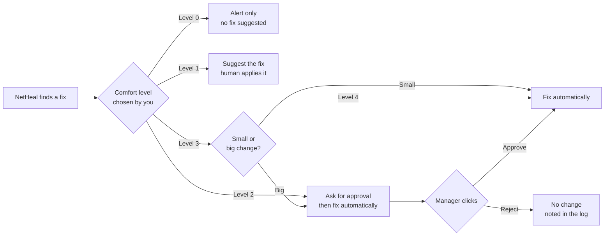
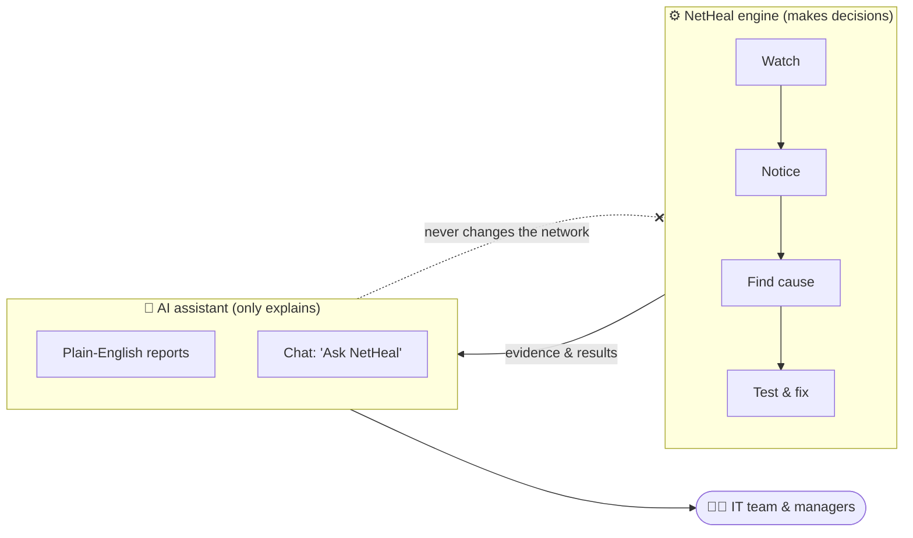

# NetHeal, explained without the tech

## What is NetHeal?

Think of NetHeal as an **automatic doctor for a computer network**.

Every college, office, hospital or factory has a network: the cables, Wi-Fi and boxes that connect every computer, phone and camera to each other and to the internet. When part of it breaks or slows down, people can't work. Usually an IT person has to notice, investigate and fix it by hand, which often takes 30–60 minutes or more.

NetHeal watches the network 24/7, notices trouble early, works out the cause, fixes it on its own (safely), and then writes a plain-English report of what happened.

**A simple comparison:** Google Maps sees a traffic jam and sends you down another road. NetHeal sees a jam or a broken road in your network and moves the data onto a clear road, usually within seconds, before most people notice.

---

## Who it's for

| Customer | Their pain | What NetHeal gives them |
|---|---|---|
| **Colleges & universities** | Wi-Fi drops in hostels and labs, slow internet during online exams and result days, small IT teams | Exams and classes keep running; fewer complaints |
| **Companies & offices** | Video calls freeze, systems go down, every minute of downtime costs money | Less downtime, faster fixes, fewer late-night calls |
| **Hospitals** | Medical systems and records must never go offline | Problems caught and fixed before they hurt patient care |
| **Factories, warehouses, campuses, smart cities** | Machines, cameras and sensors depend on the network | Operations keep running |
| **IT service companies (like Infosys)** | They manage networks for many clients | One tool that looks after every client and produces reports automatically |

---

## The main promise: five steps, done automatically

1. **Watch:** NetHeal checks the network health every half-second, like a heart monitor.
2. **Notice:** it spots something unusual early, before users start complaining.
3. **Find the cause:** it works out *what* broke and *where* (for example, "the cable to the Library building is faulty"), and shows its reasons.
4. **Fix it safely:** it **tests the fix on a virtual copy of your network first**, then applies it, for example by sending traffic down a different path.
5. **Explain it:** it writes a plain-English report: what happened, who was affected, what it did, and proof that it worked.

### Flowchart: how NetHeal handles a problem

### Flowchart: who decides (the five comfort levels)

### Flowchart: where the AI fits in

---

## Every feature, in plain words

### Seeing your network
- **Live network map:** a picture of your whole network (buildings, connections, devices) coloured **green / yellow / red** by health.
- **Moving traffic view:** small dots flow along the connections so you can *see* data moving, and see it switch to a new path when NetHeal fixes something.
- **Health score:** one number from 0 to 100 for "how healthy is my network right now".
- **Live speed and quality graphs:** how fast things are, and how much data is getting lost, updating every second.

### Catching problems early
- **Early warning:** it spots trouble while it's still small, like a doctor catching a fever early.
- **Prediction:** it can warn "this connection will be overloaded in about 2 minutes" *before* it happens.
- **Fewer false alarms:** several detection methods have to agree before it raises an alarm, so your team isn't spammed.

### Finding the cause
- **Automatic diagnosis:** it names the problem in plain words: *broken connection*, *overloaded device*, *traffic jam*, *a connection that's quietly losing data*, *a wrong setting*, or *a connection that keeps switching on and off*.
- **Confidence level:** for example, "94% sure it's the Library connection".
- **Evidence shown:** it lists *why* it thinks so, so nobody has to blindly trust a black box.

### Fixing problems automatically
- **Self-healing:** it redirects traffic around the problem, spreads the load, slows down unimportant traffic, or moves work off a struggling device.
- **Test before touching:** every fix is first tried on a **virtual copy (a "digital twin")** of your network. Only the best safe fix is used on the real one.
- **Automatic undo:** if a fix doesn't help, NetHeal reverses it on its own.
- **Safety rules:** you set limits, such as "never cut off the hospital wing" or "never change more than one thing at once", and NetHeal never breaks them.

### You stay in control
- **Five comfort levels**, from "just tell me" to "handle everything":
  - **Level 0:** watch and alert only
  - **Level 1:** suggest a fix, a human decides
  - **Level 2:** fix it, but ask for approval first
  - **Level 3:** fix small things alone, ask for big ones
  - **Level 4:** fully automatic
- **Approve with one click:** at the "ask first" levels, a manager gets the suggested fix and approves or rejects it.
- **User roles:** viewers can only look, operators can act, admins can change settings.

### Reports and explanations (AI assistant)
- **Plain-English incident reports:** produced automatically after every problem, covering what happened, the impact, the cause, the fix and the results. They can be downloaded as a PDF.
- **Before and after proof:** for example, "Speed delay went from 180 → 22 milliseconds; data loss from 14% → 0.2%; fixed in 9 seconds".
- **Ask NetHeal (chat assistant):** type questions like *"Why was the Library internet slow at 10:42?"* or *"What happened last night?"* and get clear answers with proof attached.
- **The AI only explains and never acts on its own.** All fixes come from the tested, rule-following engine, so the AI can't make a risky change by mistake.

### Trust and record-keeping
- **Tamper-proof audit log:** every event, decision and action is recorded in a way that can't be secretly edited. That helps with compliance, insurance, and settling "who changed what" questions.
- **One-click integrity check:** proves the log hasn't been tampered with.

### Practice and planning
- **"What-if" planner:** ask "What happens if the main connection fails during exam results day?" NetHeal shows the impact on the virtual copy and the ready-made fix, so you're prepared before it happens.
- **Fire-drill mode (Chaos Lab):** safely trigger fake problems on the virtual network to test your setup and train your IT staff.

### Proof that it works
- **Performance scorecard:** results from hundreds of test problems: how many were caught, how many were diagnosed correctly, the average time to fix, and the comparison with doing nothing.
- **Monthly management summary:** uptime, problems prevented, time saved, money saved.

---

## The web pages (screens) you'll see

| # | Page | What it's for (in plain words) |
|---|---|---|
| 1 | **Login** | Secure sign-in; each person sees what their role allows |
| 2 | **Live Control Room** (home) | The main screen: network map, health score, live graphs, and the current problem and its progress (*noticed → diagnosed → fixing → fixed*) |
| 3 | **Incidents** | List of all past and current problems, with status, time to fix and severity |
| 4 | **Incident details** | The full story of one problem: timeline, cause and evidence, the fix chosen, before/after graphs, and the AI report with a download button |
| 5 | **Fire-Drill Lab** | Trigger practice problems safely, set the auto-fix on/off, choose the comfort level |
| 6 | **What-If Planner** | "What if X breaks?" questions, answered on the virtual copy |
| 7 | **Ask NetHeal** | Chat with the AI assistant about your network |
| 8 | **Approvals** | Fixes waiting for a human yes/no (at the "ask first" levels) |
| 9 | **Audit Log** | Tamper-proof history of everything, with an integrity check |
| 10 | **Performance & AI Insights** | Scorecards proving how well NetHeal works |
| 11 | **Settings** | Safety rules, comfort level, users and roles, alert contacts |

---

## What a customer actually receives

1. **The NetHeal dashboard:** a website the IT team and managers open in any browser.
2. **Automatic 24/7 monitoring and self-healing** of their network.
3. **Instant alerts** when something happens. In future, by email, WhatsApp, SMS or Teams.
4. **An incident report for every problem**, written in plain English, as a PDF.
5. **A monthly health and value report** for management.
6. **A digital twin** (virtual copy) of their network for planning and practice.
7. **A complete, tamper-proof audit trail** for compliance.
8. **Setup and onboarding:** we model their campus network, set their safety rules, and train their staff.

---

## Why a business would buy it

- **Less downtime:** problems are fixed in seconds instead of an hour.
- **Smaller IT workload:** the team stops firefighting and works on improvements.
- **Safe by design:** fixes are tested first, undone automatically if they fail, and always follow your rules.
- **Transparent:** every decision is explained in plain language, with proof.
- **Ready for audits:** a complete history that can't be altered.
- **Plan ahead:** you know what will happen *before* something fails.

---

## What's in the hackathon demo vs later

**At the hackathon (7 Oct), we'll show:**
- a simulated college network
- triggering a fault
- NetHeal catching, diagnosing and fixing it live
- the graphs recovering
- the AI report
- the chat assistant
- the audit log
- the performance scorecard

**Future (for the "roadmap" part of the pitch):**
- Connect to real network equipment from Cisco, Juniper, HP and others.
- A mobile app, and alerts on WhatsApp, SMS and Teams.
- Manage many campuses or clients from one screen.
- Monthly billing plans for colleges, small businesses and enterprises.
- On-premises AI for customers who can't send data to the cloud (hospitals, government).
- Smarter AI that learns from each customer's past incidents.
