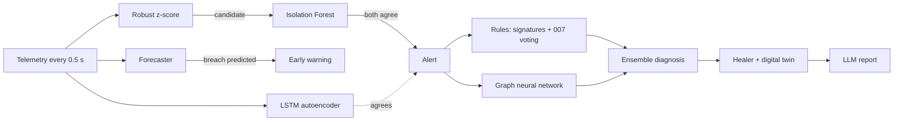

# Machine Learning in NetHeal

How NetHeal uses machine learning: what each model is, what data it learns from, how it is trained and evaluated, and how it is used live. Every number here comes from the evaluation files in [`services/ml/models/`](../services/ml/models/), produced by the training scripts in [`ml/`](../ml/) and logged to MLflow.

---

## 1. The big picture

NetHeal combines **classic statistics, machine learning and a language model**. Each one does the job it is best at:

| Stage | Technique | Type | Learns from | Used for |
|---|---|---|---|---|
| Detect | **Robust z-score** (median + MAD) | Statistics | 30 s of healthy traffic at start-up | "Is this metric far outside its normal range right now?" |
| Detect | **Isolation Forest** | Unsupervised ML | The same healthy warm-up | "Does this combination of metrics look abnormal?" (must agree with the z-score) |
| Detect | **LSTM autoencoder** | Unsupervised deep learning | 45,441 healthy 10-second sequences | "Does the last 10 s look unusual *as a sequence*?" (third opinion) |
| Predict | **Gradient-boosted forecaster** + **SHAP** | Supervised ML + explainability | ~600,000 labelled flow moments from 3,000 simulated faults | "Will this flow breach its SLA in the next 5 s?" (early warning) |
| Diagnose | **Fault signatures + 007 voting** | Expert rules | Networking knowledge + the 007 paper | "What broke, and where?" |
| Diagnose | **Graph neural network (GraphSAGE)** | Supervised deep learning on graphs | ~6,300 labelled network snapshots | A learned, independent second opinion on the root cause |
| Explain | **Llama-3.3-70B** (Qualcomm Cloud AI) | Large language model | Pre-trained (not trained by us) | Plain-English incident reports, grounded in facts |

> **Golden rule:** no ML model and no LLM can change the network on its own. Models raise alerts and give opinions. Fixes are chosen by the healer, tested on the digital twin and checked against safety rules first.



---

## 2. Where the training data comes from: our own digital twin

Real networks almost never come with **labelled** faults ("at 10:42 the gray failure on link X caused this"). NetHeal's simulator gives us labelled data for free, because we know exactly which fault we injected.

**Generator:** [`ml/datagen.py`](../ml/datagen.py)

For each of **3,000 scenarios**:
1. Copy a warmed-up network, detector and RCA engine. Four different base networks are used, each with its own noise.
2. Pick a random fault:
   - **Type:** link down, gray failure, congestion, flapping, device overload, or misconfiguration (15% each), or **no fault at all** (10%), so there are healthy examples too.
   - **Location:** any link, device or flow, **including idle backup links and core devices**.
   - **Severity:** 30–100% for the faults that have degrees.
   - **Onset:** sudden, or gradual over 5, 10, 20 or 30 s.
3. Run the **full live pipeline**: detector → RCA → **healer** (rerouting around faults, exactly like production) for 26 seconds.
4. Record:
   - **Graph snapshots** at the first moment of diagnosis, +1 s, +3 s, and +1 s / +4 s after a verified fix. Each one is labelled with the true root cause.
   - What the **rules** and **007 voting alone** answered at that moment, for a fair comparison.
   - Every flow's latency and loss over time, for the forecaster.

Snapshots are taken **after diagnosis but before healing** within each tick, the same order the live engine uses. An early version took them after healing, and the GNN never saw "link broken, traffic still failing", which is exactly when it is needed live (see §8).

**Split:** by scenario: 70% train, 15% validation, 15% test. A model is never tested on a scenario it trained on.
**Speed:** 3,000 scenarios in ~74 s on 8 CPU cores.

---

## 3. Detection: three detectors, one alert

**Code:** [`services/detector/detector.py`](../services/detector/detector.py)

### 3.1 Robust z-score (statistics)
- For the first 30 s, NetHeal records every link, device and flow and learns its **median** and **MAD** (median absolute deviation). These are robust versions of the mean and the standard deviation, so occasional spikes don't distort them.
- After that, every metric gets a score: `z = (value - median) / (1.4826 × MAD)`. A floor on the spread stops near-constant metrics from exaggerating tiny noise.
- A metric is suspicious when it moves in the *worse* direction by **more than 6** robust standard deviations. That's stricter than the textbook 3.5, which is how we keep false alarms at zero.

### 3.2 Isolation Forest (unsupervised ML)
- **Idea:** abnormal points are *easy to isolate*. Random splits separate them from the crowd in very few steps.
- **Trained on:** the healthy warm-up z-scores, one forest per entity type (100 trees).
- **Used as a vote:** a z-score candidate becomes an alert **only if the forest also says "anomalous"** (score above 0.5, the rule from the original Isolation Forest paper by Liu et al., 2008).
- **Lesson learned:** our first threshold ("more unusual than anything seen in warm-up") vetoed real faults, because forest scores level off around 0.7. Measuring this and switching to the standard rule fixed it.

### 3.3 LSTM autoencoder (deep learning, sequences)
- **Model:** [`services/ml/lstm_ae.py`](../services/ml/lstm_ae.py). An LSTM *encoder* squeezes the last **10 s (20 ticks)** of an entity's z-scores into 16 numbers, and an LSTM *decoder* tries to rebuild the sequence from them.
- **Trained on:** **healthy sequences only** (3 networks × 12.5 min, every entity, windows every 2.5 s). So it becomes very good at rebuilding normal behaviour and bad at rebuilding anything else.
- **Threshold:** the 99.9th percentile of the reconstruction error on held-out healthy data, × 1.5.
- **Results** (held-out):

  | | Value |
  |---|---|
  | Median error, healthy | 0.00007 |
  | Median error, faulty | 0.88 |
  | Faults detected | **100%** |
  | False positives on healthy data | **0%** |

- **Live role:** a *third, temporal opinion*. When it agrees with an alert, the alert lists **"LSTM autoencoder"** among its detectors. It does not raise alerts on its own, which keeps the well-tuned alerting stable.

### 3.4 Debounce and change-awareness
- An alert is raised after **3 bad readings out of 4** and cleared after **6 good ones in a row**, so it doesn't flicker.
- **Change-aware:** when the healer *deliberately* moves traffic onto a backup path, the links and devices on that path **re-learn their baseline** for 10 s instead of raising false alerts. A reset restores the original baselines.

---

## 4. Prediction: the SLA-breach forecaster

**Code:** [`services/ml/forecast.py`](../services/ml/forecast.py) · **Training:** [`ml/train_forecast.py`](../ml/train_forecast.py)

- **SLA (service-level agreement)** for a flow: packet loss ≤ 2%, latency ≤ 2× its normal value, and reachable.
- **Question it answers:** *"This flow is fine now. Will it breach its SLA in the next 5 seconds?"*
- **Features** (computed from the last 5 s of the flow): current latency ratio and loss, how much each changed over the last 2.5 s and 5 s, their averages, the peak loss, and the latency jitter. That's 10 numbers.
- **Model:** `HistGradientBoostingClassifier` (scikit-learn), 200 boosting rounds.
- **Training data:** **598,688 labelled moments**, each a flow at a tick that isn't breached yet. The label is whether it breaches within the next 5 s.
- **Threshold:** the highest probability ever seen on *healthy* validation traffic × 1.1, so healthy traffic never triggers it.

**Results** (held-out test scenarios):

| Metric | Value |
|---|---|
| Gradual faults warned **before** the SLA breach | **70 of 73 (95.9%)** |
| Median warning time before the breach | **2.5 s** |
| False warnings on 28,620 healthy test moments | **0** |
| Precision (warnings followed by a real breach) | 88% |

**Explained with SHAP** (each signal's share of the model's decisions, from `TreeExplainer` on the test warnings; plot: [`forecast_shap.png`](../services/ml/models/forecast_shap.png)):

| Signal | Share of influence |
|---|---|
| Loss change over the last 5 s | 42% |
| Peak loss in the last 5 s | 19% |
| Latency change over the last 5 s | 9% |
| Average latency ratio | 7% |
| (others) | 23% |

In plain words: **rising packet loss is the earliest sign of trouble**. The model learned to watch *trends*, not just current values.

**Live:** a predicted breach becomes a **"SLA breach predicted within 5 s"** warning in the Alerts section. When the flow really degrades, the warning upgrades to a normal alert. In a live gray-failure test, the forecaster warned **1.5 s before the breach and 3 s before the z-score detector**. For congestion and device overload, latency rises visibly, so the z-score already alerts 5–8 s before the breach and the forecaster stays quiet.

---

## 5. Diagnosis: rules + graph neural network

### 5.1 Expert rules (baseline)
**Code:** [`services/rca/engine.py`](../services/rca/engine.py)

- **Fault signatures:**
  - link down → link failure
  - lossy while up → gray failure
  - utilisation ≥ 80% → congestion
  - repeatedly up/down → flapping
  - CPU spike → device overload
  - a flow unreachable while its whole path is healthy → misconfiguration
- **007 voting** (Arzani et al., NSDI '18): what share of the struggling flows pass through each suspect.

### 5.2 Why 007 alone fails on a campus (a real finding)
007 was built for **data centres**, where many flows cross every link. In our campus, each building has essentially **one** flow to the internet, so every link on that path gets an equal vote and 007 can't pick between them. On our test set, **007 alone finds the right link only 1.5% of the time**. That's why NetHeal combines voting with each link's own telemetry (signatures).

### 5.3 The graph neural network
**Code:** [`services/ml/graph.py`](../services/ml/graph.py), [`services/ml/gnn.py`](../services/ml/gnn.py) · **Training:** [`ml/train_gnn.py`](../ml/train_gnn.py)

- **The graph:** every **device (15), link (27) and traffic flow (9)** is a vertex, 51 in total.
  - Each link connects to its two devices.
  - Each flow connects to every link and device on its current route.
  - That second kind of edge lets the network *learn* 007-style reasoning ("what do the suffering flows share?") together with the physical topology.
- **Per-vertex features (13):**
  - what kind of vertex it is
  - its z-scores
  - whether it's down
  - whether it's alerting, and how critically
  - recent up/down flips
  - utilisation or CPU, loss
  - whether it's carrying traffic
- **Model:** 3 × **GraphSAGE** layers (64 hidden units) and a classifier that labels every vertex as *"not the cause"* or one of the 6 causes. Impossible combinations are masked out (e.g. a flow can't have "congestion"). The answer is the vertex/cause pair with the highest probability.
- **Training:**
  - 6,352 labelled snapshots, 40 epochs, Adam (learning rate 0.005)
  - cross-entropy loss, with "not the cause" down-weighted to 0.05 because most vertices are innocent

**Results** (top-1 = cause *and* location exactly right, 1,781 held-out snapshots):

| Method | All snapshots | First moment of diagnosis | After healing |
|---|---|---|---|
| 007 voting alone (location only) | 1.5% | 5.1% | 0% |
| Expert rules | 90.3% | 82.4% | 100% |
| **Graph neural network** | **95.0%** | **83.3%** | 100% |
| **Ensemble** (rules + GNN) | **94.7%** | 82.4% | 100% |

Per fault type (rules / GNN / ensemble):
- **Flapping link: 62.8% / 83.6% / 74.3%.** The GNN is much better on the hardest type.
- **Link failure: 90.1% / 92.0% / 100%.** Only the ensemble is perfect.
- **Gray failure, congestion, device overload, misconfiguration:** 100% for all three.

**What this means:**
- The GNN **learned the expert rules from simulated data alone**, and then **beat them** (95.0% vs 90.3%), mostly when traffic has just been moved and voting gets confused.
- **The remaining errors are unavoidable:** at the first instant, a flapping link in its "down" phase is *physically identical* to a dead link. The GNN reflects this honestly by splitting its belief between the two (about 50/50) until it sees what the link does next.

### 5.4 The ensemble used live
```
confidence = 0.45 × signature strength  +  0.25 × vote share  +  0.30 × GNN probability
```
The Diagnosis section shows all three as bars, and the evidence includes *"Graph neural network agrees: 100%"*. If the GNN's own top pick isn't among the rule hypotheses, it is added as a candidate.

---

## 6. Explanation: the language model

**Code:** [`services/llm/reports.py`](../services/llm/reports.py)

- **Model:** **Llama-3.3-70B** on **Qualcomm Cloud AI** (Cirrascale AI Suite), via its OpenAI-compatible API.
- **We don't train it.** We give it a *fact sheet* built from the incident (devices, cause, evidence, fix, MTTD/MTTR, before/after) and instructions to use only those facts.
- **Grounding check:** a draft is rejected unless it names the real cause, every device at the root cause, and the real time-to-heal. Rejected or unavailable means a built-in template writes the report instead, so it works offline.

---

## 7. MLflow: tracking every training run

Each training script logs its **parameters, per-epoch metrics, final evaluation and model files** to MLflow (`./mlruns`):

| Experiment | Run | Key metrics |
|---|---|---|
| `netheal-rca-gnn` | graphsage-3x64 | train loss, validation accuracy per epoch, test accuracy for rules / GNN / ensemble / 007 |
| `netheal-forecaster` | hgb-sla-breach-5s | warned-before-breach %, lead time, false warnings, precision, SHAP plot |
| `netheal-lstm-autoencoder` | lstm-ae-16 | training MSE per epoch, detection rate, false-positive rate |

```bash
make mlflow   # open http://localhost:5001
make train    # regenerate the scenarios and retrain all three models (~3 min)
```

---

## 8. Lessons learned while building this

1. **Measure before trusting a threshold.** The first Isolation Forest threshold silently vetoed real faults.
2. **Make training data match production timing.** Snapshotting after healing hid the exact moment the GNN is used live. The GNN said "0%" on a real fault until this was fixed.
3. **Include your own system's actions in the data.** Without the healer in the scenarios, the GNN had never seen "traffic just moved off a faulty link" and failed there. With it, the GNN *beats* the rules.
4. **A fair baseline matters.** Our first "voting only" baseline voted on devices too and always blamed the internet gateway. The faithful 007 algorithm is the honest comparison.
5. **Calibrated doubt is a feature.** When two causes look physically identical, a good model should say 50/50, not fake certainty.

---

## 9. Files

| File | What |
|---|---|
| [`ml/datagen.py`](../ml/datagen.py) | Scenario generator (simulator → labelled data) |
| [`ml/train_gnn.py`](../ml/train_gnn.py) | GNN training + comparison with rules and 007 |
| [`ml/train_forecast.py`](../ml/train_forecast.py) | Forecaster training, calibration, SHAP |
| [`ml/train_lstm_ae.py`](../ml/train_lstm_ae.py) | LSTM autoencoder training and calibration |
| [`services/ml/graph.py`](../services/ml/graph.py) | Entity graph + features (shared by training and live) |
| [`services/ml/gnn.py`](../services/ml/gnn.py) | GNN model, ensemble, loading |
| [`services/ml/forecast.py`](../services/ml/forecast.py) | Forecaster features and live scorer |
| [`services/ml/lstm_ae.py`](../services/ml/lstm_ae.py) | Autoencoder model and live scorer |
| [`services/ml/models/`](../services/ml/models/) | Trained models + evaluation JSONs + SHAP plot |
